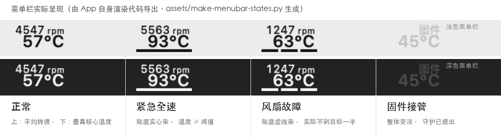

<p align="center">
  
</p>

<h1 align="center">FanPilot</h1>

<p align="center">
  <b>把 Mac 的两个风扇定在一个百分比，然后什么都不做。</b><br/>
  守护进程 5.9 MB 内存 · 0.03 % CPU · 稳态写 SMC <b>0</b> 次 —— 温度每 5 秒更新，守护 + 菜单栏合计仍低于 Macs Fan Control。
</p>

<p align="center">
  <a href="https://github.com/neosun100/FanPilot/releases/latest"></a>
  
  
  
  
  
  <a href="LICENSE"></a>
</p>

<p align="center">
  <a href="#长什么样">长什么样</a> ·
  <a href="#为什么有这个东西">为什么</a> ·
  <a href="#快速开始">快速开始</a> ·
  <a href="#架构">架构</a> ·
  <a href="#关键数字">关键数字</a> ·
  <a href="#测试">测试</a> ·
  <a href="#路线图">路线图</a>
</p>

---

## 长什么样

<p align="center">
  
</p>

菜单栏两行：上行两个风扇的**平均实际转速**（8 pt，后跟 6 pt 的 `rpm`），下行**最高核心温度**（12 pt 大字，如 `89°C`）。
宽度固定 40 pt，四种状态宽度一致，**不会横跳挤占别的图标**。图由 `assets/make-menubar-states.py` 调 App 自己的渲染代码生成。
状态标记是贴底细条而不是 emoji（模板着色模式下 emoji 会变成一坨黑块）：

| 状态 | 标记 | 什么时候 |
|---|---|---|
| 正常 | 无 | 定速运行 |
| 紧急全速 | 贴底实心条 | 温度 ≥ 阈值，两风扇打满；降到阈值 − 5 °C 以下恢复定速 |
| 风扇故障 | 贴底虚线条 | 某个风扇实际转速不到目标一半 |
| 固件接管 / 陈旧 | 整体变淡 | 守护已退出，或状态超过 3 个巡检周期没更新 |

点开下拉面板（下面是 `FanPilot --dump-menu` 的**真实输出**，不是手画的）：

```text
定速运行中  ·  稳态不写 SMC
───
最高核心   89.9 °C
全核平均   79.1 °C   ← 紧急判据 ≥90°C（还差 10.9）
───
风扇 0  —— 目标 4547 RPM（上限 5349 的 85%）
  实际 4540 RPM  ·  硬件范围 1350 ~ 5349
风扇 1  —— 目标 4910 RPM（上限 5777 的 85%）
  实际 4906 RPM  ·  硬件范围 1350 ~ 5777
───
巡检：每 5 秒只读一次（一致就不写）
写 SMC：启动以来共 4 次  ·  最近一次 16 秒前
───
固定转速        85%
  两个风扇按各自硬件上限的百分比 · 选完即刻生效
  ───
  30%   ·  1605 / 1733 RPM   ·  最静
  40%   ·  2140 / 2311 RPM   ·  安静
  50%   ·  2675 / 2889 RPM   ·  均衡
  60%   ·  3209 / 3466 RPM   ·  偏凉
  70%   ·  3744 / 4044 RPM   ·  凉 · 有风声
  80%   ·  4279 / 4622 RPM   ·  很凉 · 风声明显
  90%   ·  4814 / 5199 RPM   ·  接近全速
  100%   ·  5349 / 5777 RPM   ·  全速
  ───
  自定义百分比…（当前 85%） [✓]
───
开机自动启动
  风扇守护：开机自启 ✓（系统级，始终开启）
───
退出
```

选一档**即刻生效**（守护监视配置目录），不需要密码，也不需要「重新加载」。
要 88% 这种不在档位里的值，点「自定义百分比…」输入即可；低于硬件下限的值按下限转，**不会停转**。

---

## 为什么有这个东西

| 问题 | FanPilot 怎么处理 | 实测 |
|---|---|---|
| macOS 不让你控制风扇，固件启动阈值很高 | 两风扇定在你选的百分比 | 本机 **68.8 °C 时出厂固件仍是 0 转** |
| 两个风扇上限不同，同一个 RPM 风量占比不同 | **一个百分比**，各按自己的硬件上限折算 | 上限 5349 / 5777 ⇒ 85 % = 4547 / 4910 RPM |
| 频繁写 SMC 与整机复位相关 | 写一次就不动；只在回读与目标不一致时写 | 1.x 曲线模式 ≈ 2.3 万次/天 → **0 次** |
| 两个风扇程序互相「纠正」对方，来回拉锯 | 10 分钟被改 3 次 ⇒ **主动让步 30 分钟** | 2026-09-14 真发生过：3300 ↔ 2500 来回跳，双方都不报错 |
| 合盖睡眠时手动转速被锁存，风扇整夜转 | 睡前交还出厂固件，醒来再接管 | 2026-09-14 合盖 44 分钟，风扇按 3822 RPM 一直转（已修） |
| Macs Fan Control 常驻 148 MB | 守护是 C，App 只读一个 JSON | 5.9 MB + 50 MB，见[关键数字](#关键数字) |

> 📊 **已经在用 Macs Fan Control？** 先看 [**实测对照**](docs/COMPARISON-macs-fan-control.md) ——
> 每一行都标了证据来源，也如实写了 **MFC 更好的地方**（公证签名、机型广度、界面成熟度）。

---

## 快速开始

> **要求**：Apple Silicon Mac · macOS 13+ · 与其它风扇控制软件**互斥**（两者会抢写 SMC）

### 第 0 步：先做兼容性预检（只读，什么都不改）

FanPilot 依赖 SMC 的 `F*Tg` 键可写、`FNum` 可读、`Tp*` 传感器存在。这些在不同机型上不一定成立，
所以**先确认你的机器支不支持，再装东西** —— 不要先装一个 root 守护、然后才发现不兼容。

```bash
tar -xzf FanPilot-*.tar.gz && cd FanPilot-*/
bash install/precheck.sh
```

```text
── SMC 接口（决定能不能用）
  ✅ SMC 可读（IOServiceMatching("AppleSMC") 成功）
  ✅ 检测到 2 个风扇（FNum）
  ✅ 风扇0: 范围 1350~5349 RPM · 当前 2014 RPM · 模式 0（0=固件 1=手动）
  ✅ 风扇1: 范围 1350~5777 RPM · 当前 2018 RPM · 模式 0
  ✅ 温度传感器可读（当前最热 53.7 °C）
── 冲突检查（两个程序同时写 SMC 会互相抢，且不报错）
  ✅ 无其它风扇控制软件
```

有 ❌ 阻断项就**不要装**。预检同时检查 `/Applications` 与 `~/Applications` 里的其它风扇软件。

### 方式 A：用安装包（推荐）

从 [Releases](https://github.com/neosun100/FanPilot/releases/latest) 下载 `FanPilot-<版本>.tar.gz`：

```bash
tar -xzf FanPilot-*.tar.gz && cd FanPilot-*/
bash install.sh
```

| 步骤 | 做什么 | 要 sudo？ |
|---|---|:--:|
| 1 | 解除 Gatekeeper 隔离（见下方说明） | ❌ |
| 2 | 兼容性预检 + 冲突检查，**有阻断项就中止** | ❌ |
| 3 | 装控制守护 `fanpilotd`（root LaunchDaemon），默认 **50 %** | ✅ |
| 4 | 装菜单栏 App 到 `/Applications` + 开机自启 | ❌ |
| 5 | 跑 30 项验收（含「稳态 60 秒写 SMC = 0 次」），全绿才算成功 | ✅ |

> **为什么要 sudo**：写 SMC 风扇寄存器需要 root（读不需要）。守护是**全机唯一**能写 SMC 的进程；
> 菜单栏 App 完全无特权，只读状态文件。这个权限边界是刻意划的，见[架构](#架构)。

> **关于 Gatekeeper**：包内二进制是 **ad-hoc 签名**（没有 Apple Developer ID）。下载的文件带
> `com.apple.quarantine` 属性，`install.sh` 第一步用 `xattr -dr` 解除 —— 这是你对自己下载的东西做**显式授信**。
> 介意的话走方式 B 从源码编译。

### 方式 B：从源码编译

需要 **Xcode Command Line Tools**（`xcode-select --install`）：

```bash
git clone https://github.com/neosun100/FanPilot.git && cd FanPilot

make                 # 编译守护 fanpilotd 与命令行工具 fanctl（C，无第三方依赖）
make precheck        # 兼容性预检（只读）
make install         # 装 root LaunchDaemon（会要 sudo）
make verify          # 30 项验收，含反向断言

make app                        # 编译菜单栏 App（需要 Swift 6+）
bash install/install-app.sh     # 装 App + 开机自启（不需要 sudo）
```

### 配置

`/usr/local/etc/fanpilot/fanpilot.conf`（菜单栏选档改的就是它；手改保存后 ≤ 5 s 生效）：

```ini
percent = 85                 # 各风扇硬件上限的百分比（0~100），两风扇各自折算
check_interval = 5           # 安全巡检间隔（秒，5~60）；菜单栏温度/转速也按它更新
emergency_temp = 90          # 紧急打满阈值（°C，70~95，硬夹）
emergency_source = average   # 紧急判据：max（最高核心）/ average（全核平均）/ min
```

配置对你可写（菜单栏 App 无特权），所以它被当作**不可信输入**：所有安全阈值在守护代码里硬夹，不相信文件里写的值。

<details>
<summary><b>装了什么、装在哪</b></summary>

| 路径 | 内容 | 谁的 |
|---|---|---|
| `/usr/local/sbin/fanpilotd` | 控制守护（约 55 KB，纯 C） | root |
| `/Library/LaunchDaemons/com.newmac.fanpilotd.plist` | launchd 配置（`RunAtLoad` + `KeepAlive`，节流 10 s） | root |
| `/usr/local/etc/fanpilot/fanpilot.conf` | 配置 | **你**（App 要能改） |
| `/var/run/fanpilot.status.json` | 运行状态（守护写，`0644`） | root 写 / 所有人可读 |
| `/var/log/fanpilotd.log` | 守护日志（只记边沿事件，不按巡检刷屏） | root |
| `/Applications/FanPilot.app` | 菜单栏 App | 你 |
| `~/Library/LaunchAgents/com.newmac.fanpilot.menu.plist` | App 的开机自启 | 你 |

不装任何内核扩展、不改 SIP、不装第三方依赖、不联网。

</details>

<details>
<summary><b>确认装好了 · 卸载</b></summary>

```bash
cat /var/run/fanpilot.status.json      # mode = normal，writes_total 不再增长
sudo launchctl print system/com.newmac.fanpilotd | grep -E 'state|runs'
```

`state = running` 且 `runs` 不暴涨就对了（`runs` 短时间暴涨 = 守护在崩溃重启，看 `/var/log/fanpilotd.log`）。

```bash
sudo bash install/uninstall.sh    # 守护：先交还固件，再删文件
launchctl bootout gui/$(id -u)/com.newmac.fanpilot.menu
rm -f ~/Library/LaunchAgents/com.newmac.fanpilot.menu.plist
rm -rf /Applications/FanPilot.app
```

> 卸载脚本**先让守护把风扇交还固件，再删文件** —— 顺序反了风扇会永久留在手动模式
> （实测 SMC **不会**自动回退）。脚本里还有一道无条件兜底，强制写回 `F*md=0`。

</details>

<details>
<summary><b>常见问题</b></summary>

**菜单栏没出现图标？** App 是 `LSUIElement`（不进 Dock）。菜单栏项太多时，macOS 会把放不下的新项藏起来。
让 App 自报位置：`kill -USR1 $(pgrep -x FanPilot); cat /tmp/fanpilot-ui.json` —— `"visible": false` 就是被挤掉了：
到「系统设置 → 菜单栏」确认 FanPilot 被允许显示，或按住 ⌘ 把不常用的图标拖出菜单栏。

**「写 SMC：启动以来共 4 次」是每 10 秒写 4 次吗？** 不是。这是守护**启动以来的累计**：启动时 2 个风扇各写 2 个寄存器
（`md=1` + 目标转速）。之后巡检只读，这个数字只在你改档、睡眠/唤醒时才变；旁边的「最近一次」可以直接核验。

**菜单显示「有别的程序在改风扇 —— 暂时让步」？** 有另一个风扇软件在写 SMC。退出它，然后在菜单里改一次档即可立即接管。

**选档报 Permission denied？** 配置属主被改成了 root：`sudo chown $(whoami) /usr/local/etc/fanpilot /usr/local/etc/fanpilot/fanpilot.conf`。

**`bootstrap` 报 `5: Input/output error`？** 服务被 `launchctl disable` 过（持久开关）。`install.sh` 会自动检测并重新 enable。

**温度比别的 App 高约 10 °C？** 它们把多个键（含偏凉的传感器）混合平滑后显示；FanPilot 显示的是最热核心的原始值。
解码已逐字节核验并与第三方实现交叉验证，见 [`docs/SMC-RESEARCH.md` §3.1](docs/SMC-RESEARCH.md)。

</details>

---

## 系统要求

| | |
|---|---|
| 芯片 | Apple Silicon（风扇数取自 `FNum`、上下限取自 `F*Mn`/`F*Mx`，不硬编码） |
| 系统 | macOS 13+ · SIP 启用即可 |
| 实测机型 | **只在 MacBook Pro M5 Max（Mac17,6）/ macOS 26.6–26.7 上验证过** |
| 互斥 | 不能与 Macs Fan Control / TG Pro / smcFanControl 等同时运行 |

## 已确认的边界（不要在这上面浪费时间）

| 边界 | 为什么 |
|---|---|
| **睡眠期间不控制风扇** | 睡眠时用户态被冻结，任何程序都没有执行机会；FanPilot 睡前交还出厂固件，这是唯一安全的做法 |
| **接着外接显示器 + 电源时合盖，风扇照常转** | 这是 macOS 的「合盖模式」：机器**没有睡**，仍在工作，FanPilot 照常定速。只有真睡眠才交还固件 |
| **没有公证签名** | 没有 Apple Developer ID ⇒ 只能 ad-hoc；需要你显式解除隔离，或从源码编译 |
| **不能与其它风扇软件共存** | 两个程序写同一组寄存器、互相不知情、都不报错。FanPilot 会检测并让步，但不会和它们「打」 |
| **不再提供按温度自动调速** | 2.0 删除。自适应曲线 ≈ 2.3 万次/天写 SMC，且使用者只需要定速 —— 见 [CHANGELOG 2.0.0](CHANGELOG.md) |

---

## 架构

<p align="center">
  <picture>
    <source media="(prefers-color-scheme: dark)" srcset="assets/architecture-dark.svg"/>
    
  </picture>
</p>

两层按权限隔离：**`fanpilotd`**（root，C）是全机唯一能写 SMC 的进程，`flock` 单实例；
**`FanPilot.app`**（菜单栏，Swift/AppKit）**无任何权限**，只写配置、只读状态 JSON。
换来的是：App 崩了不影响风扇，守护不需要任何 GUI 依赖；代价是配置对用户可写 ⇒ 守护必须把它当不可信输入硬夹。

### 事件驱动：写一次，然后什么都不做

SMC 的 `F*md=1`（手动）与 `F*Tg`（目标）是**锁存**寄存器 —— 实测停写 60 秒后仍保持。所以定速只需写一次，
之后守护被三种事件**推**醒（dispatch source / IOKit 通知），外加每 5 秒一次只读巡检，没有任何轮询定时器：

<p align="center">
  <picture>
    <source media="(prefers-color-scheme: dark)" srcset="assets/check-flow-dark.svg"/>
    
  </picture>
</p>

| 事件 | 守护做什么 | 写 SMC |
|---|---|---|
| 启动 / 唤醒 / 改配置 | 回读 `md`/`Tg`，不一致才写 | 0 ~ 4 次 |
| 每 5 s 巡检 | 读 23 个温度 + 回读寄存器 | 常态 **0** |
| 系统将睡眠 | 交还固件；真正睡着前的几秒内巡检不得写回手动 | 2 次 |
| `SIGTERM` | 交还固件后退出（dispatch 信号源，即刻响应） | 2 次 |

### 状态

`status.json` 里的 `mode` 字段，菜单第一行就是它的中文：

| `mode` | 含义 | 怎么回到定速 |
|---|---|---|
| `normal` | 定速运行 | — |
| `emergency` | 紧急判据温度 ≥ 阈值，两风扇打满 | 降到阈值 − 5 °C 以下（回差，防止在阈值附近来回切） |
| `yielded_external_writer` | 10 分钟内被外部改动 3 次 ⇒ 让步 | 30 分钟后自动；或你在菜单里改一次档 |
| `write_budget_exhausted` | 写入超出令牌桶（防 bug 的保险丝） | 自动回补（2 次/分钟） |
| `failsafe_sensor_read_failed` | 读不到温度 ⇒ 已交还固件 | 传感器恢复后自动 |
| `stopped_firmware_auto` | 守护已退出，固件接管 | 重新启动守护 |

### 🔴 防写入风暴

1.x 曲线模式约 **2.3 万次/天** 写 SMC，与本机 2026-09-13~14 的 5 次 PMU 看门狗复位相关（相关 ≠ 因果）。
2.0 稳态写入为 0；以下几道是防 bug、防抢写、防「自己触发自己」的硬上限，每一道都有测试钉住：

| 防线 | 规则 | 测试里的最坏情形 |
|---|---|---|
| 写入令牌桶 | 突发 ≤ 40 次，长期 ≤ 120 次/小时，超出停写并留痕 | 每秒都想写、持续 1 小时 ⇒ 放行 ≤ 121 次 |
| 抢写让步 | 10 分钟内被外部改动 ≥ 3 次 ⇒ 让步 30 分钟 | 被持续抢写 1 天 ⇒ 纠正写入 ≤ 294 次，且不拉锯 |
| 紧急回差 | 进入 ≥ 阈值，解除 < 阈值 − 5 °C | 温度在 89/91 °C 抖 20 次 ⇒ 只切换 1 次 |
| 重载只认配置身份 | 目录事件只在配置文件 inode/size/mtime 变化时才重载 | 往配置目录造 100 次无关事件 ⇒ 重载 0 次（开发中曾实测 23 秒 4074 次） |
| 重启节流 | launchd `ThrottleInterval = 10` | 启动持续失败时不会每秒重扫 3669 个 SMC 键（1.x 是每秒一次） |
| 单实例 | 守护 `flock`；App 后来者自动退出 | 再起一个实例 ⇒ 被拒 / 自动退出 |

### 失效安全

| 场景 | 机制 |
|---|---|
| 正常退出 / `SIGTERM` / 卸载 | 写 `F*md=0` 交还固件 |
| `SIGKILL` / 崩溃 | 风扇保持锁存的定速值（安全方向）；launchd 10 s 后拉起新实例 |
| 传感器读取失败 | 立即交还固件（只在边沿写一次），不用陈旧值继续控制 |
| 系统睡眠 / 合盖 | `kIOMessageSystemWillSleep` → 交还固件；**只在完全唤醒时**重新接管 |
| 睡眠中的 DarkWake（维护唤醒） | 系统能力没有「显示」位 ⇒ **不接管**，风扇继续归固件。本机实测睡眠时约每小时一次（`rtc/Maintenance`，5~9 s），Power Nap 关着也有 |

🩸 **睡眠那一条曾经完全不存在**：2026-09-14 合盖睡眠 44 分钟，风扇按睡前的 3822 RPM 一直转。
根因是把「失效」等同于**进程死掉**，漏了「进程活着但被冻结」—— 冻结比死掉更危险：死掉有 `KeepAlive` 接管，
冻结让一条陈旧指令在硬件寄存器里无限期生效。这条最难测的路径有可离线触发的判据：

```bash
sudo fanpilotd --selftest-pm     # 投喂 WillSleep → 回读 F*md 变 0；再注入 DarkWake 投喂「已唤醒」→ 风扇必须仍归固件
```

🩸 **DarkWake 那一条是 2.1.1 才补的**：之前收到「已唤醒」就接管，而睡眠里的维护唤醒也会发这条通知
⇒ 合盖放包里每小时会把风扇冲向定速一次。现在接管的判据是 `IOPMrootDomain` 的 `System Capabilities` 含显示位（完全唤醒 = 15，DarkWake = 0x09）。
DarkWake 之后掀盖（转为完全唤醒）时系统不一定再发通知，所以每次巡检都会查这个能力位，≤ 5 s 内接上。

---

## 关键数字

2026-10-28 本机实测（M5 Max · `powermetrics --samplers tasks -i 120000 -n 1` · `ps -o rss`；巡检 5 s）：

| | CPU | 唤醒 / 秒 | 内存 | 稳态写 SMC |
|---|---:|---:|---:|---:|
| **`fanpilotd` 2.1** | **0.03 %** | **0.22** | **5.9 MB** | **0** |
| FanPilot.app 2.1（菜单栏） | 0.13 ~ 0.19 % | 0.85 ~ 1.08 | 50 MB | —（从不写） |
| `fanpilotd` 1.x（自适应） | 0.10 % | 0.66 | 5.7 MB | ≈ 2.3 万次/天 |
| Macs Fan Control 1.5.21（2026-09-20 实测） | 0.30 ~ 0.35 % | 5.6 | 148.5 MB | ≈ 0 |

**菜单栏 App 的开销几乎全在「图标换图」本身**：单变量对照 —— 巡检从 5 s 调到 60 s，App CPU 从 1.47 降到 0.22 ms/s；
`FanPilot --bench` 显示我们自己的读文件 + 画图只要 0.6 ms/次，其余（≈ 7 ms/次重画）在 AppKit 与辅助功能一侧。
所以 App 只在内容真变时才换图（温度差满 1 °C、转速差满 20 RPM 才更新菜单栏；下拉菜单里是精确值），菜单关着时不重算菜单。
想更省就把 `check_interval` 调大（60 s 时实测 App 0.02 %）。
`verify.sh` 把守护的预算钉成门禁：**CPU < 0.05 %、RSS < 8 MB、稳态 60 秒写 SMC = 0 次**，超了即验收失败。

复现：

```bash
sudo powermetrics --samplers tasks -i 120000 -n 1 | grep -E 'Name|fanpilotd|FanPilot'
ps -o pid,rss,command -p "$(pgrep -x fanpilotd)"
grep writes_total /var/run/fanpilot.status.json; sleep 60; grep writes_total /var/run/fanpilot.status.json
```

---

## 测试

```bash
make test     # 单元 66 + 验收 30 + E2E/回归 74 = 170 项
```

| 层 | 守什么 | 守不住什么 |
|---|---|---|
| `tests/unit_logic.c` · **66** | `fanlogic.h` 全部纯逻辑：配置解析（含 NaN / 垃圾值 / 注释）、硬夹、百分比折算、紧急回差、令牌桶、抢写让步 | IOKit 交互 |
| `install/verify.sh` · **30** | 装好后的事实：运行状态、失效安全、**稳态 60 秒 0 写入**、资源预算、重启节流、反向断言 | 用户路径 |
| `tests/e2e.sh` · **74** | 真机用户路径 + 按真实 bug 编号的回归，含活体：改档即刻生效、目录噪音不触发重载、原地编辑 ≤ 1 周期生效、被抢写时让步、App 单实例 | 真实合盖（见路线图） |

关键判据都做过**变异验证**：把修过的缺陷改回去（容差 50、桶容量 16、去掉回差、永远重写、去 NaN 防护、紧急不打满、让步失效、不剥注释），
测试必须变红 —— **8/8 变红**；另有 2 条接线级变异：去掉「重挂文件监听」⇒ R19 红，DarkWake 改回「无条件接管」⇒ `--selftest-pm` fail。

**反向断言和正向断言一样重要**：越界百分比必须被夹、第二个实例必须启动失败、恶意配置的安全阈值必须被夹住、
「0 次写入」必须伴随「巡检仍在进行」（否则可能是守护卡死的假绿）。

---

## 路线图

**已知缺口**（按证据强度排）

- [ ] **真机合盖复验睡眠交接** —— 代码路径已用 `--selftest-pm` 验证（回读 `F*md` 变 0），但真实合盖一次的端到端确认还没做。
      判据：合盖 10 分钟后掀开，`pmset -g log | grep "Entering Sleep"` 有条目 + 全程听不到风扇
- [ ] **其他机型** —— 只在 Mac17,6（M5 Max）实测过；`precheck.sh` 可在安装前只读自检
- [ ] **`fanctl kv` 的温度口径与守护不同** —— 它只读 5 个键（守护读 23 个）。机器可读面应改成透传守护的状态 JSON
- [ ] **下拉面板截图** —— 现在用 `--dump-menu` 的真实文本代替；菜单栏状态图由 App 渲染代码导出。不用模拟图冒充截图

**已确认不做（不要再提）**

- ~~按温度自适应调速~~ —— 2.0 删除：≈ 2.3 万次/天写 SMC，与整机复位相关；使用者只要定速（2026-10-28）
- ~~守护状态机图~~ —— 试过两轮 arcflow 布局，一个中心五个分支的结构在蛇形网格里往返边必然叠线，改用上面的状态表

---

## 文档

| | |
|---|---|
| [`CHANGELOG.md`](CHANGELOG.md) | 每个版本做了什么，每条带实测数字或复现路径 |
| [`docs/COMPARISON-macs-fan-control.md`](docs/COMPARISON-macs-fan-control.md) | 与 Macs Fan Control 的逐项实测对照（每行标注证据来源），含 MFC 更好的地方 |
| [`docs/SMC-RESEARCH.md`](docs/SMC-RESEARCH.md) | SMC 逆向调研：键位、可写性判定、传感器筛选、全部实测数据 |
| [`docs/PLAN.md`](docs/PLAN.md) | 1.x 设计档案（自适应曲线时代的决策史） |
| [`assets/diagrams/`](assets/diagrams/) | 架构图与流程图的 arcflow spec（可复现生成，不手画） |

调研工具（全部只读，不写任何 SMC 键）：

```bash
make research
./research/smcprobe    # 枚举全部 3669 个 SMC 键 + 风扇现状
./research/sensors     # 传感器普查 + 可写性属性
./research/sample 70 2 # 时序采样（判传感器响应性用）
./research/bench       # 读取开销基准
```

> 🩸 **传感器必须按「时序方差」筛，不能按瞬时值筛。** 按数值排最热的两个键是 `Tf06`=88.81 °C 与 `Tf16`=85.97 °C，
> 实测 70 秒 35 个样本**标准差 0.000** —— 它们是常量（很可能是固件跳闸点），不是实时温度。

---

## 许可

[MIT](LICENSE)
